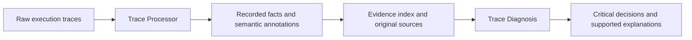

# Data Agent Trace

**Understanding how data agents perform analytical tasks, where their decisions go wrong, and what the execution evidence actually supports.**

Undergraduate research by **He Qianyi**, Computer Science, National University of Singapore. Ongoing since September 2026.

This project studies analytical behavior through two connected stages: **Trace Processor** reconstructs a workflow from heterogeneous execution records; **Trace Diagnosis** uses the recorded evidence to examine critical decisions, recovery, and supported explanations of failure.

## Research question

A final benchmark score says little about how an analysis unfolded. Which task requirements did the agent pursue? What data operations did it submit? What did the tools actually return? Did an apparent error persist or get corrected later? The project develops representations and evidence interfaces for investigating these questions across benchmark, agent-framework, and model combinations.



## Trace Processor

- Reconstructs analytical workflows while preserving original calls, code, observations, and source references.
- Connects task requirements with data operations through evidence-grounded semantic annotations.
- Separates recorded execution facts from interpretations of intent, and code definitions from observed results.
- Applies conservative static extraction and exact-quotation checks, retaining ambiguity and unknown values when the source is insufficient.

## Trace Diagnosis

- Examines material analytical decisions in the context of the original task and recorded outputs.
- Checks later recovery and competing explanations before attributing final impact to an earlier error.
- Constructs causal explanations only when the evidence supports the links; a local error alone does not establish a final root cause.
- Produces structured reports with critical decision points, supported root-cause chains, correction strategies, stage summaries, and limitations.

## Contributions and current outputs

I designed and implemented the trace-processing and diagnostic research workflow, assembled heterogeneous execution records, and developed the evidence and validation mechanisms that support inspectable failure studies. Current outputs include structured workflow representations, a curated research corpus, and diagnostic reports linked to original evidence.

This repository is a **curated research showcase**. It contains reusable modules from the working project and a small, reproducible demonstration. It is not the complete collection harness or a release of the full experimental corpus. See [scope and methodology](docs/methodology.md) and [source provenance](docs/source-provenance.json).

## Try the offline demonstration

Requires Python 3.10 or later. From the repository root:

```bash
python -m pip install -e .
python -m data_agent_trace.demo --output demo_output
python -m unittest discover -s tests -v
```

The demo uses an **entirely synthetic** trace about a missing exclusion filter. It runs the actual static extractor and exact-citation binder, then validates a **human-authored illustrative diagnosis** against the diagnostic schema. It makes no model requests and never executes the recorded analysis code.

Outputs:

- `processor_output.json`: extracted code facts, requirement evidence, and an explicitly labelled illustrative semantic annotation.
- `diagnosis_output.json`: the illustrative diagnosis and exact citations.
- `report.md`: a readable walkthrough with evidence references.

The demo is an interface example, not an experiment measuring diagnostic accuracy. The LLM runtime and real-trace results remain in the working research project.

## Repository map

| Location | Purpose |
| --- | --- |
| `src/data_agent_trace/fact_layer/` | Original conservative static-extraction modules |
| `src/data_agent_trace/semantic/` | Original requirement/operation contracts, evidence views, citation checks |
| `src/data_agent_trace/diagnosis/` | Core diagnostic instructions and JSON contract |
| `src/data_agent_trace/examples/` | Synthetic trace and illustrative annotations |
| `tests/` | Connection-resolution regression tests and evidence/demo checks |
| `docs/` | Methodology, attribution, and source provenance |

## Research tools

Python, SQL, LLM APIs, DuckDB, and JSON Schema are used in the broader research workflow. This selected offline package requires only Python and `jsonschema`; DuckDB and live LLM access are not needed for the demo.

## Interpretation limits

Static extraction does not prove that a statement executed. An exact quotation does not prove that an interpretation is correct. Structural validity does not establish causal or semantic accuracy. The system preserves these distinctions in its representations and research evaluation.

## Acknowledgements

The diagnostic output organization draws on [CodeTracer](https://github.com/NJU-LINK/CodeTracer), adapted to analytical tasks and evidence-grounded workflow inspection. Benchmark and agent-framework projects used in the broader research are credited in [acknowledgements](docs/acknowledgements.md).
