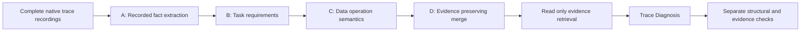

# Data Agent Trace

**Evidence-grounded Trace Processor and Trace Diagnosis for studying analytical agent behavior.**

Research by **He Qianyi**, Computer Science, National University of Singapore; ongoing since September 2026.

This repository releases the available research implementations, configurations, prompts, dependency closure, and reproduction instructions. It includes a **genuine recorded small sample** and an offline evaluator. The release preserves known failures and explicitly records unavailable evidence and evaluation assets.

## Research workflow



**Trace Processor** reconstructs analytical workflows, connects task requirements with data operations, and separates recorded facts from semantic interpretations. **Trace Diagnosis** examines critical decisions, later recovery, competing explanations, and evidence-supported consequences. The project collects traces across benchmark, agent-framework, and model combinations to support these stages.

## Release status

| Component | Available here | Validation and scope |
| --- | --- | --- |
| Trace Processor | Complete v5 fact extraction, earlier fact versions needed for historical compatibility, semantic annotation runner, contracts, merge, verification, downstream export | Offline original regression tests and a full mocked A/B/C/D integration test |
| Trace Diagnosis | Evidence index, original native retrieval tools/client, current acceptance validator, original 12-round and 24-round continuation runners, a fresh-run release adapter | Offline mocked native-tool loop; current public release did not make fresh model requests |
| Configuration and prompts | Frozen processor prompts, schema, runtime profile; diagnosis prompt/schema; current structural policy; historical scheduler profile | Local path spellings are replaced in public copies; source and release hashes are recorded |
| Real small sample | Original task, recorded steps S0004-S0006, processor annotations, original diagnosis, existing author review | A public excerpt, not a complete native recording or independent gold dataset |
| Evaluation | Strict schema, current acceptance, evidence-ID coverage, exact quotations, source hashes, static extraction | Semantic/root-cause accuracy is unavailable and remains `null` |

See [reproduction instructions](docs/reproduction.md), [evaluation protocol](docs/evaluation.md), [data scope](docs/data-release.md), and [remaining limitations](docs/availability.md).

## Quick start without a model API

Python 3.10 or later on Linux or macOS is required. The original runtime uses POSIX file locking. From the repository root:

```bash
python -m pip install -e .
python -m reproduction.evaluate \
  --sample samples/real/agriculture_22_claude \
  --output reproduction_output/real_sample_evaluation
python -m unittest discover -s tests -v
```

Use a new output directory for each evaluation. The offline command does not execute recorded analysis code or call a model.

The real sample has a useful known boundary: the actual saved diagnosis contains an extra `root_cause_chain_note` field. The strict declared schema rejects it; the current CodeTracer-compatible structural acceptance policy accepts it. Both outcomes are reported unchanged. Passing either mechanical policy does not establish diagnosis correctness.

## Full execution on your complete recordings

The public excerpt intentionally omits local workspace metadata and raw input-row previews. To run the complete native-recording pipeline, supply your own eligible recording manifest and original source files. No artificial complete recording is substituted for the excerpt.

```bash
# A: verify and extract facts from eligible original recordings; no model calls
python -m pipeline.stages.trace_processor.fact_layer_v5 \
  --manifest /path/to/eligible_recordings.jsonl \
  --output reproduction_output/facts

# B/C/D: fresh annotation and evidence-preserving merge; live API access required
python -m reproduction.processor \
  --facts reproduction_output/facts \
  --output reproduction_output/processor \
  --env-file /path/to/local-provider.env \
  --max-requests 10 --allow-network

# Verify the resulting source-bound bundle; no model calls
python -m pipeline.stages.trace_processor.merge_layer.verify \
  reproduction_output/processor/final

# Diagnosis: actual read-only retrieval tools and native model continuation
python -m reproduction.diagnose \
  --bundle reproduction_output/processor/final \
  --output reproduction_output/diagnosis \
  --env-file /path/to/local-provider.env --allow-network
```

The supplied historical provider profile uses SoCLaaS `x-test-2`, expected to return `deepseek-v4.1-flash-1017`. You must have your own authorized access. No credential or model access is provided by this repository, and another provider/model is not silently substituted. Live replay with this profile was not revalidated during this release. Details and exact fresh-run versus historical-run differences are in [the run guide](docs/reproduction.md).

## Repository map

| Path | Contents |
| --- | --- |
| `pipeline/stages/trace_processor/` | Full research fact, semantic, merge, and verification implementations |
| `pipeline/stages/evidence_builder/` | Original evidence index and read-only retrieval |
| `pipeline/stages/diagnosis/` | Current structural acceptance policy |
| `research_runners/` | Original batch/scheduler, native diagnosis, continuation, reporting and audit code |
| `scripts/` | Source-verifier, provider, downstream storage and reader dependencies |
| `configs/` | Current/frozen method contracts and release profiles |
| `reproduction/` | Portable fresh-run adapters and real-sample evaluation |
| `samples/real/` | Original recorded public excerpt and original outputs |
| `tests/` | Original unit tests and clearly labelled mocked integration tests |
| `docs/research-source-manifest.json` | Research source, source hash, release hash, and disclosed export edits |
| `src/data_agent_trace/` | Earlier selected-module API and explicitly synthetic tutorial demo, retained for compatibility |

## Reproducibility boundaries

This is a release of existing implementations and a real inspectable sample. It does not claim a finished paper evaluation, an independently labelled failure benchmark, completed baseline/ablation studies, or historical results regenerated from scratch. Model response histories and the full trace corpus are not all redistributed. The real author review is not independent gold.

New release adapters are tested with explicit offline mocks. Those mock responses are unit-test fixtures, never research results. The public real diagnosis is copied byte-for-byte from the saved experiment, including its extra field.

## Attribution

The diagnostic output organization draws on [CodeTracer](https://github.com/NJU-LINK/CodeTracer) and its linked validation convention. The real sample uses a task from [AgenticDataBench](https://github.com/AgenticDataBench/AgenticDataBench); the upstream Apache-2.0 license is included beside the sample. See [attribution and source notes](docs/acknowledgements.md). No new project-wide license or publication acceptance is asserted by this release.
