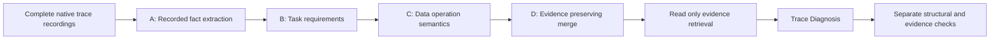

# Data Agent Trace

[](https://github.com/He-Qianyi/data-agent-trace/actions/workflows/offline-checks.yml)

**Reconstruct what a data agent did, then investigate why its analytical decisions succeed or fail.**

Independent research by **He Qianyi**, Computer Science, National University of Singapore; ongoing since September 2026.

Long analytical runs contain tool errors, recoveries and ambiguous decisions. A final answer alone cannot explain which choices mattered. This project connects task requirements to recorded data operations and diagnostic evidence through two stages:

- **Trace Processor:** reconstruct analytical workflows from native agent recordings, linking task requirements, operations and source evidence.
- **Trace Diagnosis:** use an LLM with read-only evidence tools to examine consequential decisions, recovery and alternative explanations.

## What I have built and released

The repository includes the research implementations and frozen method configurations, a complete real recording with saved model outputs and offline end-to-end replay, plus existing diagnostic experiments and processor-audit records. These are inspectable deliverables from work in progress; independent diagnostic accuracy and completed paper comparisons are still unavailable.

**Start here:** [real case walkthrough](docs/case-study.md) · [offline quick start](#quick-start-without-a-model-api) · [method](docs/methodology.md) · [current diagnosis acceptance](docs/acceptance.md)

| Work completed | Next research questions |
| --- | --- |
| Trace processing and evidence retrieval implementations; native-tool diagnosis runtime | Independent semantic evaluation and stronger comparisons |
| Complete recorded sample, offline replay and source-bound experimental records | Broader publicly redistributable samples and robustness studies |

## Research workflow



**Trace Processor** reconstructs analytical workflows, connects task requirements with data operations, and separates recorded facts from semantic interpretations. **Trace Diagnosis** examines critical decisions, later recovery, competing explanations, and evidence-supported consequences. The project collects traces across benchmark, agent-framework, and model combinations to support these stages.

## Release status

| Component | Available here | Validation and scope |
| --- | --- | --- |
| Trace Processor | Complete v5 fact extraction, earlier fact versions needed for historical compatibility, semantic annotation runner, contracts, merge, verification, downstream export | Full real-recording A/B/C/D replay, original regression tests and explicit mocked integration tests |
| Trace Diagnosis | Evidence index, original native retrieval tools/client, current acceptance validator, original 12-round and 24-round continuation runners, a fresh-run release adapter | Full recorded four-round diagnosis replay with exact native read/search verification; no fresh model calls |
| Configuration and prompts | Frozen processor prompts, schema, runtime profile; diagnosis prompt/schema; current structural policy; historical scheduler profile | Local path spellings are replaced in public copies; source and release hashes are recorded |
| Complete real sample | DABstep 1464: raw ledger/transcript, all eight tool steps, full annotations, four diagnosis rounds, saved native outputs and author review | Offline replay from raw records through processor, diagnosis and evaluation; disclosed metadata path substitutions |
| Earlier real excerpt | Agriculture 22: steps S0004-S0006 and original diagnosis | Retained unchanged for comparison; explicitly an excerpt |
| Evaluation | CodeTracer-compatible diagnosis acceptance; separate evidence coverage, source hashes, exact replay and static extraction | Legacy strict diagnosis audits are not applied by current entrypoints; semantic accuracy remains `null` |

See [reproduction instructions](docs/reproduction.md), [evaluation protocol](docs/evaluation.md), [data scope](docs/data-release.md), and [remaining limitations](docs/availability.md).

## Existing experiments and full-corpus audit evidence

The [research artifact release](research_artifacts/README.md) adds the [new ten-case diagnostic experiment and author review](research_artifacts/unseen_ten/README.md), [all-164 processor validation and 145/19 corpus selection](research_artifacts/processor_validation/README.md), and [six recorded diagnosis controls with negative outcomes](research_artifacts/diagnosis_controls/README.md).

Saved native responses and historical outcomes are retained. A separate formatting-only revalidation is labelled explicitly; it is not semantic accuracy. The experimental candidate prompt does not replace the default. Complete multi-benchmark source contexts are not all redistributed.

```bash
python -m reproduction.verify_research \
  --artifacts research_artifacts \
  --output reproduction_output/research-audit-001
```

This network-blocked audit checks published records and indexes, redoes four deterministic content spot checks and reconstructs the selection partition. It does not rerun the private full-corpus source audit. See the [verification scope](research_artifacts/README.md).

## Quick start without a model API

Python 3.10 or later on Linux or macOS is required. The original runtime uses POSIX file locking. From the repository root:

```bash
python -m pip install -e .
python -m reproduction.replay \
  --sample samples/real/dabstep_1464_claude \
  --output reproduction_output/complete_sample_replay
python -m unittest discover -s tests -v
```

Use a new output directory for each evaluation. The offline command does not execute recorded analysis code or call a model.

The complete sample replays every saved annotation and diagnosis response, and checks the original diagnostic request histories and five native tool returns. Current diagnosis acceptance uses only the [CodeTracer-compatible policy](docs/acceptance.md). Its existing author review is `needs_revision`; the semantic issue remains visible. See [sample contents, provenance and expected outcome](samples/real/dabstep_1464_claude/README.md).

The earlier Agriculture excerpt retains its extra `root_cause_chain_note` field and passes the same current acceptance policy. Its legacy strict rejection remains only in historical records. Both samples keep their known semantic limitations; structural acceptance does not establish diagnosis correctness.

## Fresh execution on your complete recordings

The complete DABstep sample above supports offline recorded-output replay. To make new model predictions on your own recordings, supply an eligible recording manifest and original source files:

```bash
# A: verify and extract facts from eligible original recordings; no model calls
python -m pipeline.stages.trace_processor.fact_layer_v5 \
  --manifest /path/to/eligible_recordings.jsonl \
  --output reproduction_output/facts

# B/C/D: fresh annotation and evidence-preserving merge; live API access required
python -m reproduction.processor \
  --facts reproduction_output/facts \
  --output reproduction_output/processor \
  --env-file /path/to/local-provider.env \
  --max-requests 10 --allow-network

# Verify the resulting source-bound bundle; no model calls
python -m pipeline.stages.trace_processor.merge_layer.verify \
  reproduction_output/processor/final

# Diagnosis: actual read-only retrieval tools and native model continuation
python -m reproduction.diagnose \
  --bundle reproduction_output/processor/final \
  --output reproduction_output/diagnosis \
  --env-file /path/to/local-provider.env --allow-network
```

The supplied historical provider profile uses SoCLaaS `x-test-2`, expected to return `deepseek-v4.1-flash-1017`. You must have your own authorized access. No credential or model access is provided by this repository, and another provider/model is not silently substituted. Live replay with this profile was not revalidated during this release. Details and exact fresh-run versus historical-run differences are in [the run guide](docs/reproduction.md).

## Repository map

| Path | Contents |
| --- | --- |
| `pipeline/stages/trace_processor/` | Full research fact, semantic, merge, and verification implementations |
| `pipeline/stages/evidence_builder/` | Original evidence index and read-only retrieval |
| `pipeline/stages/diagnosis/` | Current structural acceptance policy |
| `research_runners/` | Original batch/scheduler, native diagnosis, continuation, reporting and audit code |
| `scripts/` | Source-verifier, provider, downstream storage and reader dependencies |
| `configs/` | Current/frozen method contracts and release profiles |
| `reproduction/` | Portable fresh-run adapters, complete recorded-output replay and evaluation |
| `samples/real/` | Complete DABstep recording/output history and earlier agriculture excerpt |
| `research_artifacts/` | Saved diagnosis experiments, author reviews, controls and full-corpus audit records |
| `tests/` | Original regression tests, full real replay tests and explicitly mocked integration tests |
| `docs/research-source-manifest.json` | Research source, source hash, release hash, and disclosed export edits |
| `src/data_agent_trace/` | Earlier selected-module API and explicitly synthetic tutorial demo, retained for compatibility |

## Reproducibility boundaries

This is a release of existing implementations and a real inspectable sample. It does not claim a finished paper evaluation, an independently labelled failure benchmark, completed baseline/ablation studies, or historical results regenerated from scratch. Model response histories and the full trace corpus are not all redistributed. The real author review is not independent gold.

The complete recorded-output replay uses real saved responses, separately from software tests with explicit mocks. Both samples retain their original diagnosis bytes and known limitations. No independent semantic accuracy result is inferred from replay success.

## Attribution

The diagnostic output organization draws on [CodeTracer](https://github.com/NJU-LINK/CodeTracer) and its linked validation convention. The real sample uses a task from [AgenticDataBench](https://github.com/AgenticDataBench/AgenticDataBench); the upstream Apache-2.0 license is included beside that excerpt. The complete sample uses [DABstep](https://huggingface.co/datasets/adyen/DABstep), with its CC BY 4.0 attribution and license notice beside the sample. See [attribution and source notes](docs/acknowledgements.md). No new project-wide license or publication acceptance is asserted by this release.
